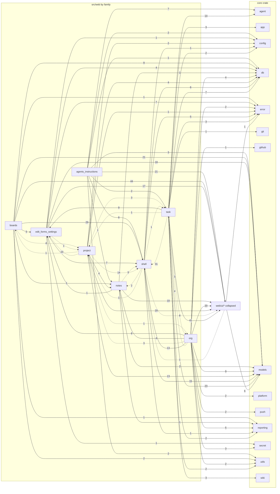
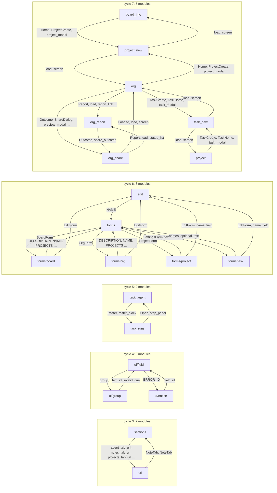
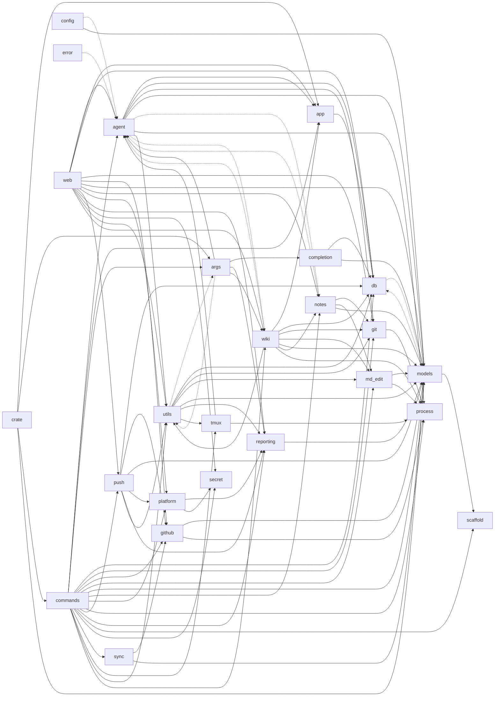
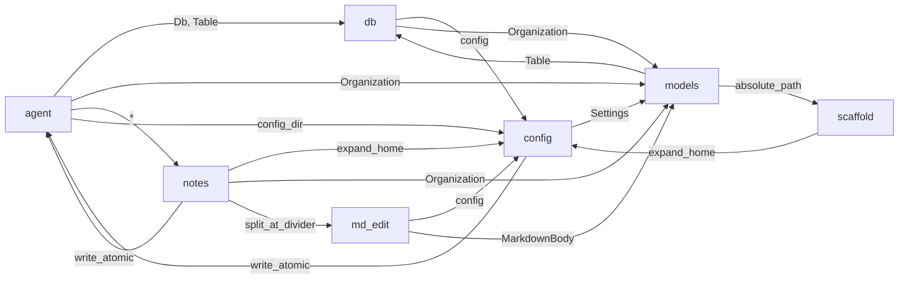

# Review 2026-11-02 — composability (module structure and boundaries)

Lens: module dependency structure of the whole crate (`src/`, 216 modules, 37.5k lines) with the
web layer in focus. Commit reviewed: `5d96f44` (branch `feat/review`). Source was not edited.

## Summary

The web layer's internal layering is in good shape: `src/web/ui/*` imports nothing but `web/assets`
(the documented exception), `src/web` never imports `src/commands`, `src/reporting` never imports
`db` or `web`, and `fixtures.rs` is `#[cfg(test)]` and unreachable from product code. The traits
`IssueTracker`, `Runner`, `EditForm`, `Table` and `Named` are used through the trait at every call
site. Against that, the module graph has **seven cycles** (SCCs with more than one node). The three
from the October review are all still there — one has doubled in size — and four are new, one of
them in the core crate. Nothing here is a user-facing bug; the cost is maintenance and test
isolation, so the ceiling is Medium.

Top 5:
1. **C1 (Medium)** The "pop-up over its host page" cycle is re-confirmed and has grown from 6 to 7
   modules: `org`, `org_report`, `org_share`, `project`, `project_new`, `task_new`, `board_info`
   import each other's `load`/`screen`. `org_share.rs:5` now reaches back into `org.rs`, and the
   `recursion_limit = "256"` in `main.rs:1-4` is a symptom of the same nesting.
2. **C2 (Medium, new)** A core cycle `config -> agent/taskdir -> notes -> md_edit -> config` plus
   `models -> scaffold -> config` and `models <-> db`. The pivot is a 10-line `write_atomic` living
   in `agent/taskdir.rs:122` and called from `config.rs:144`, `notes.rs:204,249` and `wiki/mv.rs:200`.
3. **C3 (Medium, run)** `cargo check --no-default-features` emits 36 dead-code warnings: all of
   `agent/instruction.rs` (25 items), parts of `agent/run.rs`, `wiki/ingest_job/{review,spawn}.rs`,
   `push.rs:264`, `platform.rs:160` are web-only code compiled into the CLI binary without a
   `cfg(feature = "web")` gate. The web build is warning-free.
4. **C4 (Medium)** `Multiplexer` is bypassed: `tmux.rs:235-247` exports free functions over the
   global `SYSTEM` runner and `utils/workspace.rs:88,102`, `utils/clock.rs:105,113`,
   `utils/resolve.rs:51`, `commands/project.rs:208` call them, so `project delete`, the clock and
   the hook path cannot be tested with the `FakeRunner` the trait exists for.
5. **C5-C9 (Low)** The remaining cycles: `forms <-> edit` (re-confirmed), `ui/field <-> group <->
   notice` (re-confirmed), and new `url <-> sections`, `task_agent <-> task_runs`,
   `agent/instruction <-> agent/prompt`. Each is one or two misplaced items and a small move fixes it.

Fixed since 2026-10-01: `ui::form_shell` exists and has 8 callers (old M2); `add_button` was
replaced by `add_link`/`add_post` used from `ui/table.rs` (old M5); `ui::panel` takes a `Row` enum
(old M7); `NO_PROJECTS` moved to `web/text.rs` (old M8); only one `Picked` type remains (old M3);
`project_new.rs` shrank from 411 to 279 lines (old H2, partially).

## Scope

- Every `.rs` file under `src/` (216 modules incl. 6 test-only ones). `macros/` was read only to
  confirm the path the derive emits (`macros/src/lib.rs:144`).
- Module = file; `mod.rs` = its directory; `main.rs` = `crate`.
- Not in scope: duplication (DRY lens), runtime behaviour, CSS/JS, performance.

## Method

Script: `doc/review_tools/composability/modgraph.py` (Python, stdlib only). Run:

```
cd /Users/carlorosso/.config/iter/.iter-worktrees/review
python3 -I doc/review_tools/composability/modgraph.py . --out doc/review_tools/composability/out
```

What it does:
- Strips comments, cuts out `#[cfg(test)] mod … { }` blocks and marks modules declared under
  `#[cfg(test)]` as test-only; builds one graph without and one with test code.
- Edges from `use crate::…`/`super::…`/`self::…` (multi-line, braces expanded, `as` aliases) and
  from bare `use child::Item` paths, plus every qualified `crate::a::b`/`super::a` path in code.
  `pub use sub::{Item}` re-exports in `mod.rs` files are followed, so `crate::models::Task` is an
  edge to `models/task`, not to `models`.
- Tarjan SCC, fan-in/fan-out (distinct modules), layer rules, `#[component]` call sites (counted
  only in modules that import the component from its defining module, to avoid the homonyms
  `screen`, `cell`, `row`, `status` that exist as plain functions in many files), orphan `pub`
  items (name not mentioned in any other non-test module), `config()` call sites, `fixtures`
  reachability, Mermaid output.
- Output: `doc/review_tools/composability/out/{graph.json,metrics.md,web.mmd,web_sccs.mmd,core.mmd,core_scc.mmd}`.

Also run: `cargo check --all-targets` (web, 0 warnings) and `cargo check --no-default-features`
(36 warnings) with `CARGO_TARGET_DIR=$ROOT/target`, `XDG_CONFIG_HOME=$SCRATCH/test-home`,
`ITER_PLATFORM_KEY=dummy`. Logs in `doc/review_tools/composability/out/cargo_check*.log`.

Files read in full or in the cited ranges: `main.rs`, `app.rs`, `scaffold.rs`, `git.rs` (head),
`process.rs:95-180`, `tmux.rs:1-60,235-247`, `config.rs:130-150`, `models/mod.rs:30-120`,
`models/project.rs:85-100`, `db/mod.rs:88-130`, `notes.rs:1-30`, `agent/instruction.rs:1-20,280-292`,
`agent/prompt.rs:155-180`, `web/mod.rs`, `web/ui/mod.rs`, `web/sections.rs:1-40,175-215`,
`web/url.rs:1-12,240-252`, the import blocks of `web/{org,org_share,project_new,task_new,task_agent,
task_runs,edit}.rs` and `web/forms/{mod,task,org}.rs`, `web/load.rs` (signatures),
`doc/review_composability.md`, `doc/architecture_core.md`.

Not checked: item-level edges hidden inside `view!`/`#[component]` macro expansions beyond the
regex (`name(` after an import); trait-object dispatch at runtime; whether any proposed move
changes rendered HTML; the test suite was not run (the plan's "compiles on its own" claims are
`inferred`).

Regex caveats: the edge extractor does not see paths that come purely from glob imports of an
external crate; the component counter under-counts a component re-exported through a second
module (e.g. `detail_screen`/`list_screen` used by `agents.rs` via `instructions`); the orphan
list is name-based and so over-approximates (a name used only inside its file is "orphan" even if
it must be `pub` for a macro).

## Dependency graphs

### Web layer by family (`ui/*` collapsed; edge label = number of module-level edges)



Hubs inside `shell`: `web/url` (fan-in 40), `web` (mod.rs: `open_db`, `Id`, `now`; fan-in 30),
`web/load` (17), `web/sections` (13), `web/crumbs`, `web/text`. Dashed = both directions exist.

### Web cycles, module level (only intra-cycle edges, labelled with the items that close them)



### Core layer (directories collapsed; `error` and `config` edges omitted: every module has them)



### The core cycle (SCC 1), collapsed to directories



## Findings

| ID | Severity | Where | Evidence | Effort | One-line fix |
|---|---|---|---|---|---|
| C1 | Medium | `web/org.rs:7-12`, `web/org_share.rs:5`, `web/project_new.rs:3,6`, `web/task_new.rs:7-8`, `web/board_info.rs` | run+read | M | Make `project_modal`/`task_modal`/`share_modal` pure views; move `Home`/`TaskHome`/`*Create` to `web/create.rs`; hosts pass `screen` in |
| C2 | Medium | `agent/taskdir.rs:122`, `config.rs:144`, `notes.rs:204,249`, `wiki/mv.rs:5`, `models/project.rs:94`, `models/mod.rs:1` | run+read | S | Move `write_atomic` to `utils/fs.rs`; resolve `absolute_path` in the callers, not in `Project::validate` |
| C3 | Medium | `agent/instruction.rs` (25 items), `agent/run.rs:41,177,207`, `wiki/ingest_job/review.rs:77,87`, `wiki/ingest_job/spawn.rs:57`, `push.rs:264`, `platform.rs:160`, `agent/plan.rs:93`, `agent/error.rs:23`, `notes.rs:146`, `agent/taskdir.rs:140` | run | S-M | `#[cfg(feature = "web")]` on the web-only items or move them under `src/web/` |
| C4 | Medium | `tmux.rs:235-247`; callers `utils/workspace.rs:88,102`, `utils/clock.rs:105,113`, `utils/resolve.rs:51`, `commands/project.rs:208` | read | M | Delete the free functions; thread `&dyn Multiplexer` (e.g. a field on `App`) |
| C5 | Low | `web/edit.rs:3` <-> `web/forms/{task,org,project,board}.rs` (`forms/task.rs:8`) | run+read | S | Move `NAME`/`DESCRIPTION` (`forms/mod.rs:17-18`) into `edit.rs` |
| C6 | Low | `web/ui/field.rs:6,8`, `web/ui/group.rs:3`, `web/ui/notice.rs:3` | run+read | S | `ui/field_ids.rs` holding `field_id`, `hint_id`, `invalid_cue`, `ERROR_ID` |
| C7 | Low | `web/url.rs:4,245-246` <-> `web/sections.rs:5` | run+read | S | Move `NoteTab` into `url.rs` (or take `&str`); pass the default query to `url` instead of importing `task_query::DEFAULT` |
| C8 | Low | `web/task_agent.rs:3` <-> `web/task_runs.rs:5` | run+read | S | Move `Roster`/`roster_block` (`task_runs.rs:64,324`) into `task_agent`, or `Open`/`step_panel` (`task_agent.rs:95,262`) into a `task_steps.rs` |
| C9 | Low | `agent/instruction.rs:5` <-> `agent/prompt.rs:164-177` | run+read | S | Move `instruction::file`/`split` (`instruction.rs:52,57`) next to `prompt::template`, or into `wiki/frontmatter` |
| C10 | Low | `web/org_share.rs` (665 lines, fan-out 20), `web/task_runs.rs` (543, 22, 5× `config()`), `web/task_agent.rs` (530, 17), `push.rs` (833), `wiki/graph.rs` (853), `agent/instruction.rs` (617) | run | M | Split `org_share` into the share dialog (view) and the push bridge (`github`/`platform`/`push`); split `task_runs` into roster/compose/run-page |
| C11 | Low | `utils/report.rs:5` -> `args::ReportOpts`; `args/mod.rs:8` -> `utils/output::Format` | run+read | S | Move `resolve_range` into `commands` or give it plain `(from, to, period)` arguments |
| C12 | Low | `app.rs:1-4`; `web/task.rs:69`, `web/task_agent.rs:448,484`, `web/task_runs.rs:398`; 13 modules call `config()` (18 calls) | run+read | S | One non-test constructor `App::over(db, now)`; carry the config in `App` so pages stop reading the global |
| C13 | Low | `models/mod.rs:1`, `macros/src/lib.rs:144` | run+read | M | Move the `Table` trait to `models/table.rs` (the derive emits `crate::db::Table`; change the path once) |
| C14 | Low | 96 `pub` items used only in their own file (`out/metrics.md` "Orphan pub items") | run | S | Drop `pub` or narrow to `pub(super)`; the 14 `db/migrate.rs` steps and the `AgentBackend` trait (`agent/run.rs:78`) are the clearest cases |
| C15 | Low | one-use components, see table below | run | S | Inline `matrix_grid`, `info_body`, `board_root`, `side_lists`; keep the rest |
| C16 | Low | `web/url.rs` (368 lines, fan-in 40) | run | S | Part of C7; otherwise acceptable as the one URL authority |

### C1 — Page-overlay cycle (SCC 7, 7 modules) — Medium, run+read

Re-confirmed from the October review (H1), larger: `folders` left the cycle, `org_report` and
`org_share` joined it. Edges (script output):

- `org -> org_report` (`Report`, `load`, `report_view`), `org -> org_share` (`ShareDialog`,
  `preview_modal`, `share_modal`), `org -> project_new` (`Home`, `project_modal`),
  `org -> task_new` (`TaskHome`, `task_modal`)
- `org_share -> org` (`Loaded`, `load`, `screen`: `org_share.rs:5`), `org_share -> org_report`
- `project_new -> org`, `project_new -> board_info` (`load as load_board, screen as board_screen`:
  `project_new.rs:3,6`); `task_new -> org`, `task_new -> project` (`task_new.rs:7-8`)
- `board_info -> project_new`, `project -> task_new`, `org_report -> org_share`

Cost: none of the seven can be read or unit-tested alone; every pop-up change touches its host
page's private `load`/`screen`; `main.rs:1-4` raises `recursion_limit` to 256 because of the
nesting in `org.rs`. User impact: none today. Fix as in the table; `project_new.rs:30-60` already
has `Home` as a data-only enum, so the move is mechanical.

### C2 — Core cycle (SCC 1, 15 modules incl. parent/child) — Medium, run+read

Cross-directory edges that close it (parent/child edges within `models/` and `db/` are normal):

- `config -> agent/taskdir`: `config.rs:144` calls `crate::agent::taskdir::write_atomic` to save
  `iter.yaml`. `notes.rs:204,249` and `wiki/mv.rs:5` do the same. So the config module depends on
  the agent subsystem for a filesystem helper.
- `agent/taskdir -> config, db, models, notes` (legitimate; it is glue).
- `models/project -> scaffold -> config`: `Project::validate` (`models/project.rs:94`) calls
  `scaffold::absolute_path`, which calls `config::expand_home` and `std::path::absolute` (cwd).
  A model's validation is cwd- and HOME-dependent, which is why `forms/project.rs` tests need a
  real path.
- `models -> db` (`Table`) and `db -> models`: see C13.
- `md_edit -> config, models`; `notes -> md_edit` (`split_at_divider`): acceptable one-way edges
  once the two above are cut.

Fix order: (1) `utils/fs.rs::write_atomic`, re-export from `taskdir` for one commit if wanted;
(2) make `validate` take an already-absolute path and do the `absolute_path` call in
`commands/project.rs` and `web/forms/project.rs`. After both, `config`, `notes`, `scaffold` and
`md_edit` leave the SCC; what remains is `models <-> db`.

### C3 — Web-only code compiled into the CLI without a gate — Medium, run

```
cargo check --no-default-features 2>&1 | grep -c '^warning'   # 36 (binary), 17 with --all-targets
```

`agent/instruction.rs:10-335` (`Source`, `Layers`, `layers_of`, `global`, `Front`, `parse_front`,
`Instruction`, `valid_name`, `is_builtin`, `rename_target`, `KINDS`, `builtin`, `find`, `list`,
`check`, `preferred_model`, `starter_prompt`, `Fields`, `compose`, …), `agent/run.rs:41,177,207`,
`wiki/ingest_job/review.rs:77,87`, `wiki/ingest_job/spawn.rs:57`, `push.rs:264`, `platform.rs:160`,
`agent/plan.rs:93`, `agent/error.rs:23`, `notes.rs:146`, `agent/taskdir.rs:140`. The web build has
zero warnings, so these are reachable only from `src/web`. Impact: a CLI-only CI job with
`-D warnings` fails; ~700 lines compile into the CLI binary for nothing; the module boundary
"agent = shared by CLI and web" is not what the code says. Fix: gate `agent/instruction` and the
listed items with `#[cfg(feature = "web")]`, or move the instruction *editing* half (`compose`,
`Fields`, `rename_target`, `check`) into `src/web/instructions/`.

### C4 — `Multiplexer` bypassed by free functions — Medium, read

`tmux.rs:7-60` defines the trait "so tests need no server" and `TmuxClient<'_>` over a
`&dyn Runner` (`tmux.rs:77`). `commands/session.rs:42,156` and `commands/misc.rs:36,64,79` honour
it. But `tmux.rs:235-247` also exports `kill_session`, `current_session_name`,
`take_detach_message`, `any_client_attached` built on the global `SYSTEM` runner, and
`utils/workspace.rs:88,102`, `utils/clock.rs:105,113`, `utils/resolve.rs:51`,
`commands/project.rs:208` call those. Consequence: `project delete`, task teardown and the clock
(the paths the architecture notes call the risky ones, `doc/architecture_core.md` "Workspace
teardown") run against real tmux in tests or are untested. The seed finding about positional names
(`tmux.rs:290`) lives on exactly this path. Fix: put a `tmux: Box<dyn Multiplexer>` on `App`
(`app.rs:9-12`), delete the four free functions, pass `&app.tmux` down `utils::workspace`.

### C5-C9 — the small cycles — Low

- **C5** `edit.rs:3 use super::forms::NAME` while `forms/{task,org,project,board}.rs` implement
  `web::edit::EditForm` (`forms/task.rs:8`). Re-confirmed (old H4). Move the two consts.
- **C6** `ui/field.rs:6,8` -> `group`, `notice::ERROR_ID`; `ui/group.rs:3` -> `field::{hint_id,
  invalid_cue}`; `ui/notice.rs:3` -> `field::field_id`. Re-confirmed (old M1). The only cycle
  inside `ui/`.
- **C7** New. `url.rs:245` takes `super::sections::NoteTab`; `sections.rs:5` imports six
  `*_tab_url` builders. `url.rs:4` still imports `task_query::DEFAULT` (old H3 re-confirmed).
- **C8** New. `task_agent.rs:3` needs `task_runs::{Roster, roster_block}` while `task_runs.rs:5`
  needs `task_agent::{Open, step_panel}`. Two 500-line modules that must be read together.
- **C9** New. `agent/instruction.rs:5` imports `prompt::{Context, Kind}` and `prompt.rs:164-177`
  reaches back for `instruction::file`/`split`. The `split` is front-matter splitting, which also
  exists in `wiki/frontmatter.rs` and `md_edit::split_at_divider` (DRY lens; here it only matters
  because it closes the cycle).

### C10 — God modules — Low

Threshold: fan-out > 12 or > 500 lines. 40 modules exceed it (full list in `out/metrics.md`);
most are pages whose fan-out is 15-30 `ui::*` imports, which is the intended "page = aggregation
of components" shape and not a smell. The ones that mix concerns:

- `web/org_share.rs` (665 lines, fan-out 20): share dialog, text preview, platform push via
  `github`, `platform`, `push`, `secret` (`org_share.rs:13-19`). The page is the orchestrator.
- `web/task_runs.rs` (543, 22): roster table, compose form, run page, `config()` read 5 times.
- `web/task_agent.rs` (530, 17), `push.rs` (833, 13), `wiki/graph.rs` (853), `agent/instruction.rs`
  (617), `platform.rs` (603), `tmux.rs` (591).

### C12 — `config()` as a global — Low

13 modules, 18 calls (`web/task_runs` 5, `md_edit` 2, the rest 1). `app.rs:1-4` says "no config
field: config() is already global". The web layer constructs `App` by hand in three places
(`web/task.rs:69`, `web/task_agent.rs:448,484`, `web/task_runs.rs:398`) because the only
constructor besides `App::new()` is `#[cfg(test)] with_db` (`app.rs:27`). A plain
`App::over(db, now)` removes the three hand-built structs, and a `config: &'static Config` field
would make the 18 reads injectable.

### C13 — `models -> db::Table` — Low

The one layer-rule violation the script reports (`models/mod.rs:1 use crate::db::Table`; every
`#[derive(Table)]` in `models/*.rs` emits `impl crate::db::Table` via `macros/src/lib.rs:144`).
It is by design (the trait describes storage), and no model touches `rusqlite` directly: raw SQL
exists only under `src/db/` (plus `wiki/graph.rs:411`, which is oxigraph, not SQLite). Cosmetic;
moving the trait to `models/table.rs` and changing one path in the macro would make `db` depend
on `models` only.

### C15 — Component call-site counts

141 `#[component]`s; 76 have exactly one call site, 34 have two. Full table in `out/metrics.md`.
Judgement:

| Keep (real logic or consistency) | Inline (bare wrapper) |
|---|---|
| `hour_grid`, `hour_slot`, `day_nav` (agenda only, but the grid is the feature) | `matrix_grid` (`ui/layout.rs`: one `div.quad-grid`) |
| `quadrant`, `task_table`, `folded_list`, `checklist`, `palette`, `search_button` | `info_body` (`ui/layout.rs`, used once by `board_info`) |
| `breadcrumb` inside `page_header`, `tag_chips` inside `panel`, `error_box` inside `form` (internal composition) | `board_root` (`ui/board_root.rs`, 30 lines, one caller) |
| page fragments defined in their own page (`facts`, `output_part`, `prompt_part`, `settings_part`, `use_row`, `info`, `projects_tab`, `overview`, `*_block`): single-use by construction, they split a long `view!` for readability | `side_lists` (`ui/layout.rs`, bare `<aside>`) |
| `site_footer` / `site_footer_for` / `layout`: three layers for one footer; the middle one (`footer.rs`, 172 lines) does the DB work so keep, but `layout.rs` (43 lines) could fold into `footer.rs` | |

Components with the widest reuse (sanity check that the layering pays off): `field` 35 sites /
18 modules, `cell` 32, `frame` 14, `empty_line` 14, `page_header` 13, `row` 13, `notice` 12,
`select` 11, `textarea` 11, `data_table` 9, `form_shell` 8, `modal` 8, `post_button` 8, `tabs` 8.

### Trait boundaries (summary)

| Trait | Defined | Impls | Used through the trait? |
|---|---|---|---|
| `Table` (`db/mod.rs:95`) | db | 8 derives in `models/*` | Yes: all SQL in `src/db/`; `Db::{list,find_by_name,…}<T: Table>` |
| `Named` (`models/mod.rs:91`), `ProjectGroup` | models | via derive | Yes: `db/mod.rs:234-275`, `utils/crud.rs:11,22`, `forms/mod.rs:68`, `utils/output.rs` |
| `PlatformItem` | `platform.rs:35` | it is a struct, not a trait (renamed from `Named` per commit `40e603f`) | n/a |
| `EditForm` (`web/edit.rs:9`) | web | 4 (`forms/*`) | Yes: `edit.rs` generic over `F: EditForm`; `project_new`/`task_new` use `edit::create_to` (not bypassing) |
| `Multiplexer` (`tmux.rs:7`) | tmux | `TmuxClient` | Partly: see C4 |
| `IssueTracker` (`github.rs:56`) | github | `GhCli`, `Inert` (test), `FakeGh` (test) | Yes: every consumer takes `&dyn IssueTracker` (`push.rs:311`, `commands/sync.rs`, `commands/task.rs`, `web/org_share.rs:239-279`) |
| `Runner` (`process.rs:136`) | process | `SystemRunner`, `FakeRunner` | Yes for `GhCli`/`TmuxClient`. Direct `Command::new` elsewhere: `agent/exec.rs:15`, `agent/solve.rs:262`, `wiki/ingest_job/spawn.rs:36`, `secret.rs:95,125`, `web/folder_picker.rs:16,33`, `web/mod.rs:142` — each is a different kind of process (agent harness, self re-exec, keychain, GUI picker, browser), so not a bypass of `Runner`'s purpose, but `agent/exec` has no fake |
| `Tool` (`process.rs:99`) | process | `Git` only | `git.rs` free functions wrap it; callers use `git::*`, never `Tool` directly. Fine. |
| `AgentBackend` (`agent/run.rs:78`) | agent | `ClaudeCode` only | Yes via `Harness::backend()` (`run.rs:70`), but the trait is `pub` and never named outside `run.rs` (orphan); the `Harness` enum is the real switch |

`config()`: 13 modules, 18 reads (table in `out/metrics.md`). `fixtures.rs`: declared
`#[cfg(test)] mod fixtures` (`main.rs:14-15`); the non-test graph has no edge to it (run).

## Raw metrics

### Top 20 by fan-out (distinct modules imported, non-test code)

| module | fan-out | fan-in | lines |
|---|---|---|---|
| `web/instructions` | 30 | 1 | 181 |
| `commands/task` | 29 | 1 | 459 |
| `web/org` | 29 | 3 | 242 |
| `web/task` | 27 | 0 | 203 |
| `web/project` | 24 | 1 | 155 |
| `web/daily_notes` | 22 | 4 | 360 |
| `web/task_runs` | 22 | 4 | 543 |
| `commands/project` | 21 | 1 | 240 |
| `web/agents` | 20 | 0 | 365 |
| `web/org_share` | 20 | 2 | 665 |
| `web/task_new` | 20 | 2 | 288 |
| `web/agenda` | 19 | 0 | 303 |
| `commands/organization` | 18 | 0 | 255 |
| `web/org_edit` | 18 | 0 | 139 |
| `web/project_new` | 18 | 2 | 279 |
| `wiki/ingest_job` | 18 | 6 | 129 |
| `agent/solve` | 17 | 3 | 480 |
| `web/matrix` | 17 | 0 | 220 |
| `web/project_edit` | 17 | 0 | 113 |
| `web/task_agent` | 17 | 3 | 530 |

### Top 20 by fan-in

| module | fan-in | fan-out | lines |
|---|---|---|---|
| `error` | 69 | 1 | 274 |
| `db` | 66 | 12 | 334 |
| `models/task` | 53 | 1 | 394 |
| `models/project` | 48 | 5 | 105 |
| `web/url` | 40 | 3 | 368 |
| `web` | 30 | 3 | 148 |
| `models/organization` | 29 | 4 | 126 |
| `config` | 23 | 4 | 379 |
| `app` | 21 | 1 | 34 |
| `web/ui/icons` | 21 | 0 | 47 |
| `models` | 20 | 11 | 172 |
| `models/board` | 20 | 4 | 44 |
| `web/ui/field` | 20 | 5 | 329 |
| `agent/taskdir` | 18 | 9 | 273 |
| `utils/resolve` | 18 | 7 | 124 |
| `models/tag` | 17 | 2 | 179 |
| `web/load` | 17 | 7 | 182 |
| `models/settings` | 15 | 3 | 81 |
| `web/forms` | 15 | 7 | 192 |
| `web/ui/form_error` | 15 | 1 | 85 |

### Strongly connected components with > 1 node (non-test code)

#### SCC 1: 15 modules

`agent/taskdir`, `config`, `db`, `db/sqltypes`, `md_edit`, `models`, `models/board`, `models/organization`, `models/project`, `models/session`, `models/settings`, `models/tag`, `models/task`, `notes`, `scaffold`

- `agent/taskdir` -> `db`: Db, Table
- `agent/taskdir` -> `models/organization`: Organization
- `agent/taskdir` -> `models/project`: Project
- `agent/taskdir` -> `models/task`: Task
- `agent/taskdir` -> `notes`: *
- `agent/taskdir` -> `config`: q:config_dir
- `config` -> `models/settings`: Settings
- `config` -> `models/task`: TaskStatus
- `config` -> `agent/taskdir`: q:write_atomic
- `db` -> `config`: config
- `db` -> `models/organization`: Organization
- `db` -> `models/board`: Board, Card
- `db` -> `models/task`: Duration, Task, TaskStatus
- `db` -> `models/tag`: IMPORTANT_TAG, Priority, Tag, URGENT_TAG
- `db` -> `models`: Named, ProjectGroup, task_ref
- `db` -> `models/project`: Project
- `db` -> `models/session`: Session
- `db` -> `db/sqltypes`: datetime
- `db/sqltypes` -> `db`: *, q:read, q:write
- `md_edit` -> `config`: config
- `md_edit` -> `models`: MarkdownBody
- `models` -> `db`: Table
- `models` -> `models/board`: Board, Card
- `models` -> `models/organization`: Organization
- `models` -> `models/project`: Project
- `models` -> `models/session`: Session
- `models` -> `models/settings`: Configured, Settings
- `models` -> `models/tag`: IMPORTANT_TAG, Priority, Tag, URGENT_TAG, is_hex_color
- `models` -> `models/task`: Duration, START_TIME_FMT, Task, TaskEdit, TaskStatus, end_text …
- `models/board` -> `models`: q:ProjectGroup
- `models/board` -> `models/project`: q:Project
- `models/board` -> `models/task`: q:Task
- `models/board` -> `models/tag`: q:Priority
- `models/organization` -> `models/settings`: Configured, Settings
- `models/organization` -> `models`: default_branch_template, default_true, main_branch, q:ProjectGroup
- `models/organization` -> `models/project`: q:Project
- `models/project` -> `models`: Named, default_branch_template, default_true, main_branch, require_no_comma
- `models/project` -> `models/settings`: Configured, Settings
- `models/project` -> `models/organization`: Organization
- `models/project` -> `scaffold`: q:absolute_path
- `models/session` -> `models/task`: Duration
- `models/settings` -> `models`: default_branch_template, default_true, main_branch
- `models/settings` -> `models/organization`: q:Organization
- `models/settings` -> `models/project`: q:Project
- `models/tag` -> `models`: q:require_no_comma
- `models/task` -> `models`: q:MarkdownBody, q:read_wrapped
- `notes` -> `config`: expand_home
- `notes` -> `models/organization`: Organization
- `notes` -> `models/project`: Project
- `notes` -> `md_edit`: q:split_at_divider
- `notes` -> `agent/taskdir`: q:write_atomic
- `scaffold` -> `config`: q:expand_home

#### SCC 2: 2 modules

`agent/instruction`, `agent/prompt`

- `agent/instruction` -> `agent/prompt`: Context, Kind, self
- `agent/prompt` -> `agent/instruction`: q:file, q:split

#### SCC 3: 2 modules

`web/sections`, `web/url`

- `web/sections` -> `web/url`: agent_tab_url, notes_tab_url, projects_tab_url, sessions_tab_url, tasks_tab_url, wiki_tab_url
- `web/url` -> `web/sections`: NoteTab, q:NoteTab

#### SCC 4: 3 modules

`web/ui/field`, `web/ui/group`, `web/ui/notice`

- `web/ui/field` -> `web/ui/group`: group
- `web/ui/field` -> `web/ui/notice`: ERROR_ID
- `web/ui/group` -> `web/ui/field`: hint_id, invalid_cue
- `web/ui/notice` -> `web/ui/field`: field_id

#### SCC 5: 2 modules

`web/task_agent`, `web/task_runs`

- `web/task_agent` -> `web/task_runs`: Roster, roster_block
- `web/task_runs` -> `web/task_agent`: Open, step_panel

#### SCC 6: 6 modules

`web/edit`, `web/forms`, `web/forms/board`, `web/forms/org`, `web/forms/project`, `web/forms/task`

- `web/edit` -> `web/forms`: NAME
- `web/forms` -> `web/forms/board`: BoardForm
- `web/forms` -> `web/forms/org`: OrgForm
- `web/forms` -> `web/forms/project`: ProjectForm
- `web/forms` -> `web/forms/task`: TaskForm
- `web/forms/board` -> `web/forms`: DESCRIPTION, NAME, PROJECTS, Pairs, text
- `web/forms/board` -> `web/edit`: EditForm
- `web/forms/org` -> `web/forms`: DESCRIPTION, NAME, PROJECTS, Pairs, SettingsForm, text
- `web/forms/org` -> `web/edit`: EditForm
- `web/forms/project` -> `web/forms`: SettingsForm, text
- `web/forms/project` -> `web/edit`: EditForm, name_field
- `web/forms/task` -> `web/forms`: names, optional, text
- `web/forms/task` -> `web/edit`: EditForm, name_field

#### SCC 7: 7 modules

`web/board_info`, `web/org`, `web/org_report`, `web/org_share`, `web/project`, `web/project_new`, `web/task_new`

- `web/board_info` -> `web/project_new`: Home, ProjectCreate, project_modal
- `web/org` -> `web/org_report`: Report, q:load, report_link, report_view, tab_url
- `web/org` -> `web/org_share`: Outcome, ShareDialog, preview_modal, share_modal
- `web/org` -> `web/project_new`: Home, ProjectCreate, project_modal
- `web/org` -> `web/task_new`: TaskCreate, TaskHome, task_modal
- `web/org_report` -> `web/org_share`: Outcome, share_outcome
- `web/org_share` -> `web/org`: Loaded, load, screen
- `web/org_share` -> `web/org_report`: q:Report, q:load, q:status_list
- `web/project` -> `web/task_new`: TaskCreate, TaskHome, task_modal
- `web/project_new` -> `web/board_info`: load, screen
- `web/project_new` -> `web/org`: load, screen
- `web/task_new` -> `web/org`: load, screen
- `web/task_new` -> `web/project`: load, screen

#### SCCs including test code

- `agent/error`, `agent/exec`, `agent/instruction`, `agent/prompt`, `agent/run`, `agent/solve`, `agent/task_prompt`, `agent/taskdir`, `app`, `args`, `commands`, `commands/agent`, `commands/ingest`, `commands/misc`, `commands/project`, `commands/solve`, `commands/sync`, `commands/task`, `completion`, `config`, `crate`, `db`, `db/sqltypes`, `error`, `fixtures`, `git`, `github`, `md_edit`, `models`, `models/board`, `models/organization`, `models/project`, `models/session`, `models/settings`, `models/tag`, `models/task`, `notes`, `process`, `reporting`, `reporting/merge`, `reporting/render`, `reporting/worklog`, `scaffold`, `sync`, `tmux`, `utils/clock`, `utils/crud`, `utils/output`, `utils/report`, `utils/resolve`, `utils/workspace`, `wiki/check`, `wiki/frontmatter`, `wiki/graph`, `wiki/ingest`, `wiki/ingest_job`, `wiki/ingest_job/bridge`, `wiki/ingest_job/spawn`, `wiki/ontology`, `wiki/retrieve`, `wiki/schema`, `wiki/scope`, `wiki/testutil`
- `web/sections`, `web/url`
- `web/ui/field`, `web/ui/group`, `web/ui/notice`
- `web/task_agent`, `web/task_runs`
- `web/edit`, `web/forms`, `web/forms/board`, `web/forms/org`, `web/forms/project`, `web/forms/task`
- `web/board_info`, `web/org`, `web/org_report`, `web/org_share`, `web/project`, `web/project_new`, `web/task_new`

## Ordered simplification plan

Each step compiles on its own and should pass the existing tests (inferred; none was executed).

1. **`utils/fs.rs::write_atomic`** — move the function from `agent/taskdir.rs:122`, update
   `config.rs:144`, `notes.rs:204,249`, `wiki/mv.rs:5`, `taskdir` itself. Unblocks: `config`,
   `notes`, `wiki/mv` no longer depend on `agent`; SCC 1 shrinks. Effort S.
2. **`absolute_path` out of `Project::validate`** (`models/project.rs:94`) into
   `commands/project.rs` and `web/forms/project.rs`. Unblocks: `models` no longer depends on
   `scaffold`/`config`; model tests become cwd-independent. Effort S.
3. **Gate web-only agent code** (C3): `#[cfg(feature = "web")]` on `agent/instruction` items and
   the eight others. Unblocks: a warning-free `--no-default-features` build; makes step 10's split
   obvious. Effort S.
4. **`ui/field_ids.rs`** (C6) and **`NAME`/`DESCRIPTION` into `edit.rs`** (C5). Two moves, both
   inside `web`. Unblocks: `ui/` becomes cycle-free; `forms` depends on `edit` one way. Effort S.
5. **`NoteTab` into `url.rs`** and **`DEFAULT` passed as a parameter** (C7). Unblocks: `url` has
   fan-out 1 (`reporting::fmt_date`), so it can later move to its own file set per entity. Effort S.
6. **`Roster`/`roster_block` into `task_agent`** or `Open`/`step_panel` into `task_steps.rs` (C8);
   **`instruction::file`/`split` next to `prompt::template`** (C9). Effort S each.
7. **`create.rs`** for `Home`, `TaskHome`, `ProjectCreate`, `TaskCreate`; make `project_modal`,
   `task_modal`, `share_modal`, `preview_modal` pure views that receive the host's rendered
   `screen` as a `Child`; `org_share` gets `Loaded` passed in from `org` (C1). Unblocks: 7 modules
   become a DAG; `recursion_limit` can be tried at 128. Effort M.
8. **`App::over(db, now)` + `tmux` field** (C12, C4): first the constructor (removes three
   hand-built `App`s), then the `Multiplexer` field and deletion of `tmux.rs:235-247`. Unblocks:
   `project delete`/clock tests with `FakeRunner`. Effort M.
9. **Split `org_share.rs`** into dialog + push bridge; **split `task_runs.rs`** into roster /
   compose / run page (C10). Effort M.
10. **`Table` trait to `models/table.rs`** (C13), one path change in `macros/src/lib.rs:144`.
    Unblocks: `models` is a leaf layer; the layer rule holds literally. Effort M (touches every
    derive import).
11. **Visibility pass** over the 96 orphan `pub` items (C14) and the four wrapper components
    (C15). Effort S, cosmetic.

## Confidence

- High: the module graph, SCCs, fan-in/out, layer-rule result, `config()` counts, fixtures
  reachability, the 36 CLI warnings — all mechanical and spot-checked against the source
  (every cycle edge in C1-C9 was confirmed by reading the cited line).
- Medium: component call-site counts (regex + import filter; under-counts re-exported
  components), the god-module judgement, the "keep vs inline" table.
- Medium-low: the plan's "compiles and passes tests on its own" (not executed), and the claim
  that `recursion_limit` can drop after step 7.

## Out-of-scope observations

- Security: none new from this lens. The `Multiplexer` bypass (C4) is the path the seed finding
  about positional tmux names (`tmux.rs:290`) runs on, so fixing C4 is also where that fix would
  be tested. `web/org_share.rs` imports `secret::Keychain` directly (`org_share.rs:19`) — the web
  page holds the key material path rather than delegating to `push`; worth a look by the security
  lens.
- `App` has no `config` and web pages open the DB themselves (`web/mod.rs:78 open_db`), which is
  the structural cause of the "DB opened twice per page" seed finding (performance lens).
- `--no-default-features` warnings include `notes.rs:146 is_note_file` and
  `agent/taskdir.rs:140 in_notes`, which look like plain dead code rather than web-only.

## What I could not assess

- Whether topcoat's `view!`/`#[component]` macros force the current file granularity (the
  `recursion_limit` note suggests nesting depth matters).
- Runtime equivalence of any proposed merge (CSS selectors may depend on wrapper elements).
- Edges created only through trait-object dispatch or macro-generated code the regex cannot see.
- Test coverage of the pieces proposed for movement; inline `#[cfg(test)]` modules would move
  with them.
